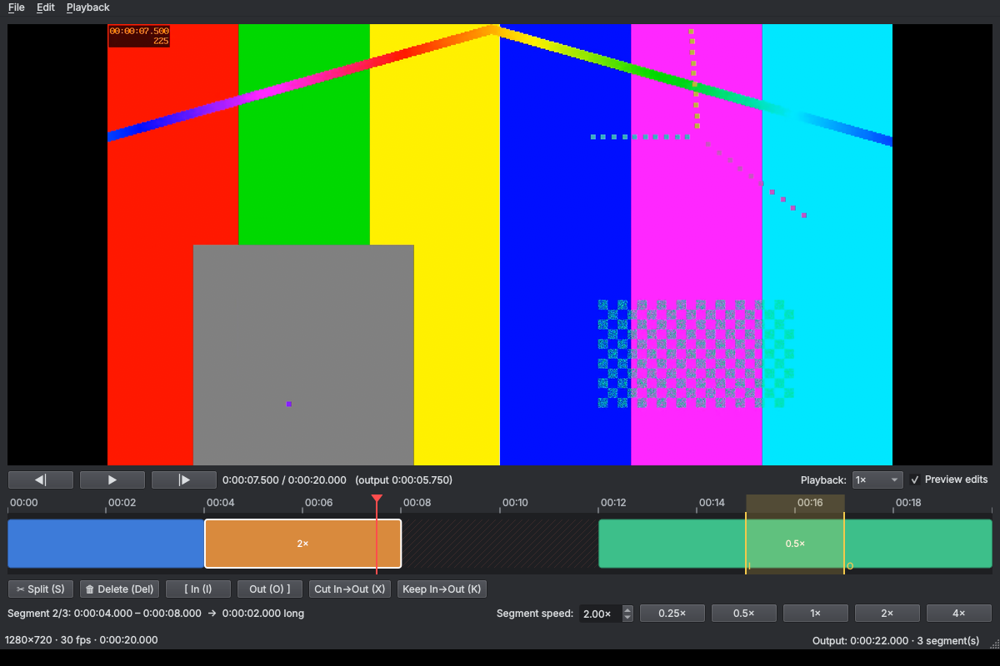

# Simple Montage

A small Windows video editor for **cutting** and **changing speed** — nothing more.



- Combine several videos on one timeline, reorder or remove them
- Split the video at the playhead, delete parts, or cut/keep an In→Out range
- Change the order of segments: drag them on the timeline or use ◀ Move / Move ▶
- Give every segment its own speed (0.1× – 10×), audio keeps its pitch
- Zoom into the picture per segment (1× – 5×) and choose which part is shown
- Adjust lighting per segment: brightness, contrast, saturation, gamma
- Put another video on top (picture-in-picture): size, position, timing, optional sound
- Frame-exact preview with frame stepping; playback can preview the edit (skips cuts, applies speeds)
- Export the whole timeline or only part of it (e.g. second 5 to 10)
- One-click export of any single segment, of all segments as separate files, or of a cut-out part
- Export video with sound, video without sound, or **sound only** (MP3 / WAV / M4A)
- Preview volume slider and mute (remembered between runs)
- Undo / redo

---

## How to run it on Windows

### Step 1 — Install Python (once)

1. Go to <https://www.python.org/downloads/windows/> and download the latest
   **Windows installer (64-bit)** (Python 3.11 or newer; 3.12 or 3.13 recommended).
2. Run it and **tick "Add python.exe to PATH"** at the bottom of the first screen, then click *Install Now*.

> If typing `python` in a terminal opens the Microsoft Store, Python is **not** installed —
> that is only a Store shortcut. Install it from python.org as above.

### Step 2 — Get the code

Either clone it with git, or on the GitHub page click the green **Code** button →
**Download ZIP**, then extract the ZIP to a normal folder (e.g. `C:\Projects\Simple-Montage`).
Do not run it from inside the ZIP.

### Step 3 — Start it

**Easiest: double-click `run.bat`** in the project folder.

The first time it takes a few minutes. It:
1. creates a private Python environment in the `.venv` folder,
2. installs the Python packages (PySide6, python-mpv),
3. downloads `ffmpeg.exe`, `ffprobe.exe` and `libmpv-2.dll` into the `bin` folder (~300 MB),
4. starts the app.

After that, double-clicking `run.bat` starts the app right away. You can also drag a video
file onto `run.bat` to open it. The black console window shows errors if something goes wrong
— keep it open while you use the app.

### Doing the same steps by hand (optional)

Open **Command Prompt** (press Win, type `cmd`, Enter) — *not* PowerShell — and go to the project folder:

```bash
cd /d C:\Projects\Simple-Montage
```

Create the environment:

```bash
py -m venv .venv
```

Install the packages (this uses the environment's own Python, so no "activate" step is needed):

```bash
.venv\Scripts\python.exe -m pip install -e .
```

Download FFmpeg and libmpv into `bin\`:

```bash
powershell -NoProfile -ExecutionPolicy Bypass -File packaging\fetch_binaries.ps1
```

Check that everything is in place:

```bash
.venv\Scripts\python.exe -m simple_montage --check
```

Start the app:

```bash
.venv\Scripts\python.exe -m simple_montage
```

### If something does not work

First run the check — it tells you what is missing:

```bash
.venv\Scripts\python.exe -m simple_montage --check
```

| You see | What it means / fix |
|---------|---------------------|
| `'python' is not recognized` or the Microsoft Store opens | Python is not installed or not on PATH. Install it from python.org with "Add python.exe to PATH" ticked, then open a **new** terminal. |
| `running scripts is disabled on this system` (when running `activate`) | PowerShell blocks the activate script. You don't need it: use `.venv\Scripts\python.exe ...` as shown above, or use `run.bat`. |
| `No module named simple_montage` | You are not in the project folder, or used the system Python instead of `.venv\Scripts\python.exe`, or step "Install the packages" was skipped. |
| `No matching distribution found for PySide6` | Your Python is 32-bit or too old. Install the 64-bit Python 3.12/3.13 installer, delete the `.venv` folder, try again. |
| `libmpv-2.dll could not be loaded` / `libmpv: NOT LOADED` | `bin\libmpv-2.dll` is missing. Run the download step again. If it says it cannot extract the `.7z` file, install [7-Zip](https://www.7-zip.org/) and retry. |
| `ffprobe not found` / `ffmpeg: NOT FOUND` | `bin\ffmpeg.exe` / `bin\ffprobe.exe` are missing. Run the download step again (or copy them in by hand — see [`bin/README.md`](bin/README.md)). |
| Something else | Delete the `.venv` folder, run `run.bat` again, and copy the text from the console window. |

---

## How editing works

The timeline shows the **source** video. Coloured blocks are the parts that are kept
(blue = normal speed, orange = faster, green = slower); hatched areas are cut out.
Click a block to select it, then delete it or change its speed.

| Key | Action |
|-----|--------|
| Space | Play / pause |
| ← / → | Previous / next frame |
| Shift + ← / → | Back / forward 1 second |
| ↑ / ↓ | Previous / next cut point |
| Home / End | Start / end |
| + / − | Preview volume up / down |
| M | Mute / unmute preview |
| S | Split at playhead |
| Ctrl+← / Ctrl+→ | Move selected segment earlier / later |
| Del | Delete selected segment or overlay |
| I / O | Set In / Out mark |
| X | Cut out In→Out |
| K | Keep only In→Out |
| Esc | Clear marks |
| Ctrl+Z / Ctrl+Y | Undo / redo |
| Ctrl+O / Ctrl+E | Open / export |
| Ctrl+Shift+E | Export selected segment |
| Right-click timeline | Export menu (segment, all segments, cut-out part) |
| Ctrl+Shift+A | Add video to the end (combine) |
| Ctrl+Shift+O | Add overlay video |
| Mouse wheel on timeline | Zoom (Shift+wheel scrolls) |
| Drag a segment | Move it to another place in the order |
| Drag on the ruler | Scrub |

## Changing the order of segments

After splitting (**S**), you can move pieces around:

- **Drag a segment sideways** on the timeline and drop it where a yellow *move here* line shows.
- Or select it and click **◀ Move** / **Move ▶** (Ctrl+← / Ctrl+→), or right-click →
  *Move this segment earlier / later*.

A moved segment keeps its speed, zoom, lighting and overlays. Cut-out (striped) parts between
segments stay where they are. Pieces taken from the same file show which part they are, e.g.
`rgb.mp4 (6.0–9.0 s)`. Undo works as usual.

To scrub (drag the playhead), drag on the time ruler or on a striped cut-out area — dragging on
a segment moves the segment.

## Combining videos

- **➕ Add video** (or **File → Add video to the end…**, Ctrl+Shift+A) appends one or more
  videos after what is already on the timeline. You can also drag files onto the window and
  choose *Add to the end of the timeline*.
- Clips are shown with their number and name; dashed white lines mark where one ends and the
  next begins.
- **Right-click** a clip on the timeline → *Move clip earlier / later* or *Remove clip from the
  timeline*. Its cuts, speed, zoom, lighting and overlays move with it. Undo works for all of it.
- Everything else works across clips: split, cut, speed, zoom, light, overlays, range export
  and the ⬇ segment buttons.
- The **first clip sets the output size and frame rate**. Clips with a different shape are fitted
  in with black bars; clips without sound are silent in the result.

## Zooming

Every segment can be zoomed into, just like it can have its own speed:

1. Select a segment on the timeline (to zoom the whole video, don't split it — it is one segment).
2. Set **Segment zoom** (e.g. click **2×**, or type any value from 1× to 5×).
3. Drag the box in the small frame map on the right to choose **which part** of the picture
   is shown. Double-click the map or press **Center** to go back to the middle.

The preview shows the zoom immediately (with *Preview edits* ticked), and the export keeps
exactly that area, scaled back up to the original resolution. To zoom only one moment, split
the video around it (**S**) and zoom just that segment. Zoomed segments show 🔍 on the timeline.

## Lighting

Open the **☀ Light** tab. The sliders change the **selected segment**:
brightness, contrast, saturation (colour) and gamma (shadows / midtones).
To change only part of the video, split it (**S**) at the start and end of that part, then
select the piece in the middle. **Reset light** goes back to the original look.
Segments with changed lighting show ☀ on the timeline. The preview uses the same filter as the
export, so what you see is what you get.

## Overlay video (picture-in-picture)

1. Move the playhead to where the overlay should appear.
2. **File → Add overlay video…** (Ctrl+Shift+O), or the **🖼 Overlay video** tab → *Add overlay video…*.
3. It appears as a purple block under the timeline and in the preview (bottom-right, 35% wide).
4. In the **Overlay video** tab:
   - **Size** slider — width compared to the main picture
   - drag the box in the frame map, or use the corner buttons, to **place** it
   - **Show at / for / starting from its second** — when it appears, how long, and which part
     of the overlay video is used
   - **Mix in its sound** — otherwise only the main video's sound is used
   - **Zoom into it** — zoom into the overlay's own picture (1× – 5×); drag the box in the
     *Visible part* map to choose which part of it is shown
5. Drag the purple block on the timeline to move it in time; **Del** removes the selected overlay.

The overlay follows your edit of the main video: parts you cut out are skipped for it too, and
sped-up/slowed-down segments change its speed as well. Several overlays are allowed; where they
overlap, the later one is on top (the preview shows the top one).

## Exporting

### Quick: export one piece

As soon as you split or cut the video, every kept segment on the timeline gets a small
**⬇ button** in its corner. Click it, choose a file name and type, done:
**MP4** = video with sound, **MP3 / WAV / M4A** = sound only.
The segment is exported with its speed, zoom, lighting and any overlays.

Other ways:
- select a segment and click **⬇ Export segment** (or Ctrl+Shift+E)
- **right-click** the timeline:
  - on a segment → *Export this segment…*
  - anywhere → *Export all segments as separate files…* (choose MP4, MP3 or WAV and a folder;
    you get `name_part01.mp4`, `name_part02.mp4`, …)
  - on a cut-out (striped) part → *Export this cut-out part, original…* — saves the piece you
    removed, unedited
- **File → Export all segments separately…**

### Full export window

**File → Export…** (Ctrl+E) opens the export window:

- **Part of the timeline**
  - *Whole timeline*
  - *In → Out marks* — set them with **I** and **O** first; this is selected automatically when marks exist
  - *Custom range* — type the start and end in seconds, e.g. from `5` to `10`

  Times are positions on the timeline ruler. Parts you cut out inside the range stay cut out
  and speed changes are applied, so the window shows the resulting length before you export.
  Exporting a range does not change your edit.
- **What to export**
  - *Video with sound* → MP4
  - *Video only, no sound* → MP4
  - *Sound only* → MP3, WAV or M4A (pick the type in the save window)

## Tech stack

| Part | Used for |
|------|----------|
| Python 3.11+ | language |
| PySide6 (Qt 6) | window, timeline, controls |
| python-mpv + libmpv | video preview (exact seeking, frame stepping, variable speed) |
| FFmpeg / ffprobe | reading video info and exporting |

## Project layout

```
run.bat               one-click setup + start on Windows
src/simple_montage/
  app.py              entry point, theme, --check diagnostics
  main_window.py      main window: actions, playback, editing commands
  player.py           libmpv preview widget
  timeline_widget.py  custom-painted timeline
  export_dialog.py    export window (range, video/sound)
  zoom_navigator.py   frame map for choosing the zoomed area / overlay position
  panels.py           Light and Overlay tabs
  model.py            edit model (segments, speeds, undo/redo) — no GUI code
  export.py           builds the FFmpeg command — no GUI code
  export_runner.py    runs FFmpeg in the background with progress
  probe.py            reads video info with ffprobe
  tools.py            finds ffmpeg / ffprobe / libmpv
tests/                unit tests + end-to-end FFmpeg export tests
packaging/            download script for FFmpeg/libmpv; optional .exe build
```

Run the tests with:

```bash
.venv\Scripts\python.exe -m pip install -e .[dev]
```

```bash
.venv\Scripts\python.exe -m pytest
```

## Optional: standalone .exe

Not needed to use the app. If you want one later, run the **Build Windows app** workflow
manually from the GitHub **Actions** tab, or locally:

```bash
powershell -ExecutionPolicy Bypass -File packaging\build_windows.ps1
```

## Ideas for next steps

- Save / load projects
- Reverse and freeze-frame segments
- Smooth slow motion (frame interpolation)
- Multiple source clips and reordering
- Export presets (quality, resolution)
